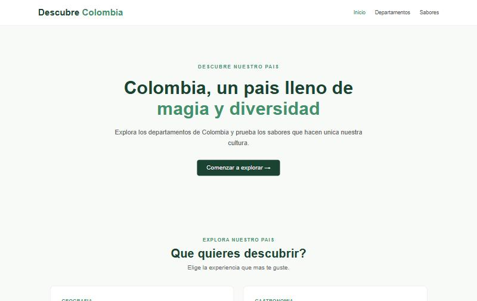
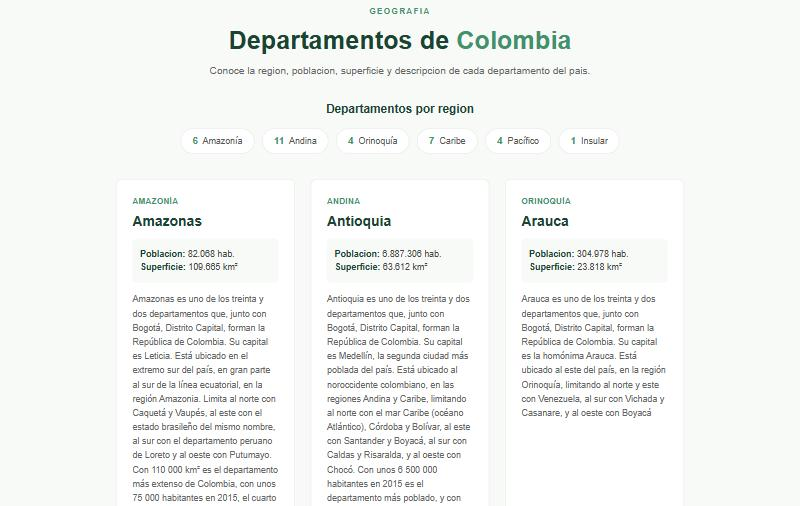
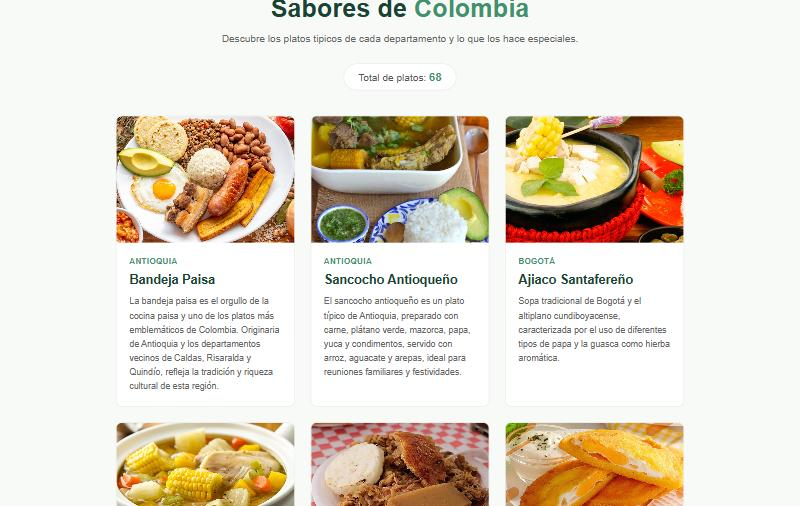

# Descubre Colombia

## Descripcion

Este es un mini portal sobre Colombia que hice para el Reto 3 de JavaScript. Los datos los saco de la  API Colombia (https://api-colombia.com/) usando `fetch` y los muestro en la pagina creando todo desde JavaScript.

Escogi 2 de las opciones del reto:

- **Departamentos de Colombia:** muestra los 33 departamentos (los 32 + Bogota) con su region, poblacion, superficie y descripcion. De extra cuenta cuantos departamentos hay en cada region.
- **Sabores de Colombia:** muestra los 68 platos tipicos con su foto, nombre, descripcion y el departamento de donde son. De extra muestra el total de platos.

Las dos paginas tienen mensaje de "Cargando..." mientras llegan los datos, y si la API falla sale un mensaje de error (con `catch`).

Algunas imagenes de la API no cargaban (Tamal Tolimense, Arroz de Lisa, Ternera a la llanera, Dulce de guayaba y Arroz con pollo), entonces las cambie por imagenes de Wikimedia Commons. Y si alguna otra falla, sale una imagen de "Imagen no disponible".

## Tecnologias

- HTML
- CSS
- JavaScript
- API Colombia

## Estructura

- `index.html`: la pagina de inicio
- `html/`: las paginas de departamentos y sabores
- `css/`: los estilos
- `js/`: el codigo que trae los datos de la API
- `img/`: las capturas y las fotos de los platos que no cargaban

## Capturas

### Inicio

### Departamentos

### Sabores

## Autor

Hecho por Juan David Paz - Campuslands
